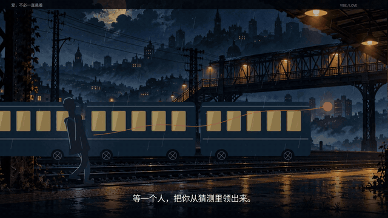

# 爱，不必一直悬着 · V2

另有新作品：[Hello Kitty 桌面宠物 V2.1：全屏自动隐藏、分层动作与 Windows 下载](desktop-pet/README.md)。

**纯背景音乐＋中文字幕，无配音、无口播。** 横屏 16:9，约 1 分 59 秒。

新版重制了 20 个动作镜头：人物行走、伸手、蹲下、坐下、递灯，列车横穿、钟摆摆动、纸团抛落、镜面碎裂、地面合拢、树枝生长与灯光交叠。场景从冷色房间与雨夜站台，逐渐转入暖光花房。

## 下载新版

- [1080P 完整成片（MP4，约 31 MB）](https://github.com/kittliyu123-creator/vibe/raw/refs/heads/main/deliverables/vibe-v2-music-only-1080p.mp4)
- [720P 兼容版（MP4，约 11 MB）](https://github.com/kittliyu123-creator/vibe/raw/refs/heads/main/deliverables/vibe-v2-music-only-720p.mp4)
- [ZIP 包：720P 成片、字幕与文案](https://github.com/kittliyu123-creator/vibe/raw/refs/heads/main/deliverables/vibe-v2-download.zip)

本页下载入口均指向 V2 无口播新版。如果浏览器直接播放视频，可使用播放器菜单中的下载或“视频另存为”。

## 动效片段预览

下方 GIF 展示四段镜头运动；完整视频在上方下载，包含原背景音乐。

## 配套文件

- [完整字幕、四句金句与镜头说明](deliverables/script-v2.md)
- [SRT 字幕](deliverables/subtitles-v2.srt)

视频规格：1920 × 1080 / 1280 × 720，24 fps，H.264 视频与 AAC 立体声音频。音轨直接保留用户提供的原背景音乐，未加入旁白或额外音效。
