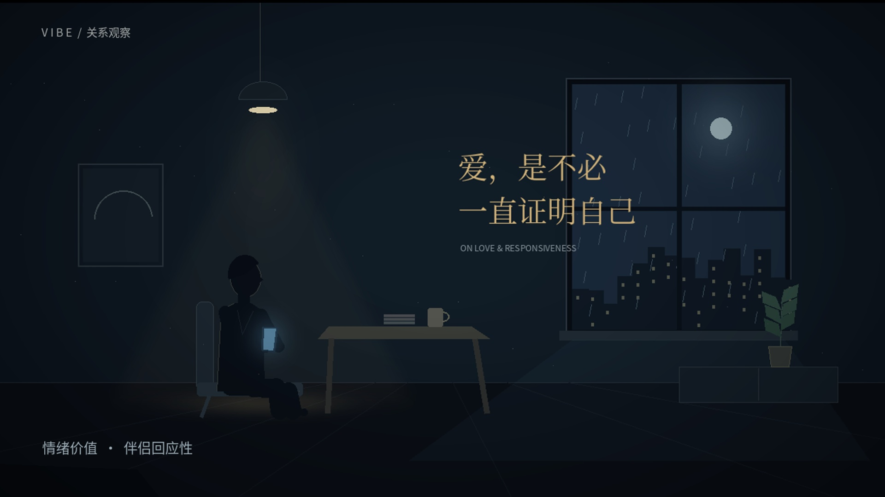

# 爱，是不必一直证明自己

横屏知识短片，以「情绪价值 / 伴侣回应性」为主题。时长约 1 分 59 秒，包含原创 2D 剪影动画、中文合成男声旁白、配乐与字幕。

## 下载视频

- [1080P 成片（MP4，约 26 MB）](https://github.com/kittliyu123-creator/vibe/raw/refs/heads/main/deliverables/vibe-love-1080p.mp4)
- [720P 兼容版（MP4，约 4 MB）](https://github.com/kittliyu123-creator/vibe/raw/refs/heads/main/deliverables/vibe-love-720p.mp4)
- [下载 ZIP 包：720P 视频、封面、字幕和文案](https://github.com/kittliyu123-creator/vibe/raw/refs/heads/main/deliverables/vibe-download.zip)

如果浏览器直接播放视频，可使用播放器菜单中的下载或“视频另存为”。也可进入 [交付文件目录](deliverables)，打开对应文件后点击 GitHub 的下载按钮。

## 配套文件

- [完整文案、四句金句与制作说明](deliverables/script.md)
- [SRT 字幕](deliverables/subtitles.srt)
- [封面图片](deliverables/cover.jpg)

视频规格：16:9，24 fps，H.264 视频、AAC 立体声音频。1080P 版本为 1920 × 1080，兼容版为 1280 × 720。
